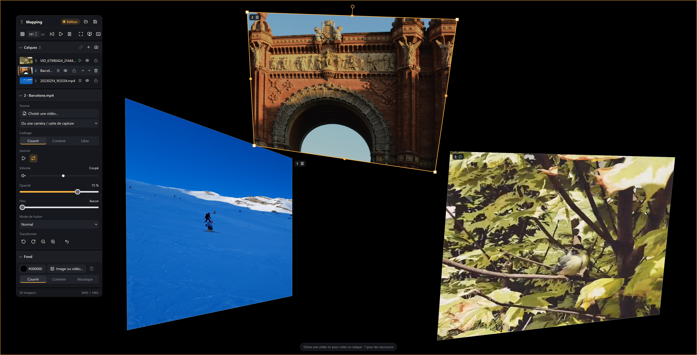

# 🎃 Video Mapper

**Projetez vos vidéos sur n'importe quelle surface, directement depuis le navigateur.**
**Project your videos onto any surface, straight from the browser.**

[🇫🇷 Français](#-français) · [🇬🇧 English](#-english)



---

## 🇫🇷 Français

### Le mapping vidéo, sans logiciel à installer

Une façade de maison pour Halloween, une vitrine, un décor de théâtre, une sculpture, un mur de salle de concert : **Video Mapper** déforme vos vidéos en temps réel pour qu'elles épousent parfaitement les surfaces réelles sur lesquelles vous les projetez.

Branchez un vidéoprojecteur, ouvrez `index.html` dans Chrome ou Edge, glissez vos vidéos, ajustez les quatre coins… et c'est en place. Pas d'installation, pas de compte, pas de serveur, pas de licence : **un dossier, un navigateur, c'est tout.**

### ✨ Pourquoi Video Mapper ?

- **Zéro installation** : une page HTML et du JavaScript pur. Fonctionne hors ligne, même sur une machine sans droits administrateur.
- **Rendu GPU (WebGL2)** : correction de perspective exacte (homographie) calculée sur la carte graphique, fluide même avec plusieurs vidéos HD.
- **Pensé pour le terrain** : grandes poignées, réglage au pixel au clavier, mode diffusion en un appui, sauvegarde automatique. On règle en quelques minutes, dans le noir, sur une échelle.
- **Léger et lisible** : environ 1 000 lignes de code sans framework ni étape de compilation. Facile à comprendre, à modifier et à faire évoluer.

### 🎬 Fonctionnalités

#### Calques vidéo illimités
- Ajoutez autant de calques que nécessaire, chacun avec sa propre vidéo.
- **Sources** : fichiers vidéo locaux **ou flux en direct** depuis une webcam ou une carte de capture (HDMI, caméra…).
- Liste des calques avec **miniatures animées**, ordre de superposition (passer devant / derrière), **masquer**, **verrouiller**, supprimer (avec annulation possible).

#### Déformation et placement à la souris
- **Coins** : déformation libre en perspective (avec `Maj` : redimensionnement).
- **Milieux des bords** : agrandir / réduire en gardant les proportions.
- **Poignée de rotation** (avec `Maj` : par pas de 15°).
- **Glisser** pour déplacer, **molette** pour redimensionner, `Alt` + molette pour pivoter.
- **Clavier** : flèches pour ajuster au pixel (`Maj` : ×10), `Tab` pour passer d'un coin à l'autre.
- **Grille d'alignement** au pas réglable.

#### Réglages par calque
- **Cadrage** : *Couvrir* (remplit la surface), *Contenir* (montre toute la vidéo), *Libre* (étire sur les 4 coins).
- **Lecture** : lecture / pause, boucle.
- **Son** : volume, coupure, et **vumètre en direct** intégré au curseur.
- **Opacité** et **flou gaussien** (calculé sur le GPU).
- **Modes de fusion** : Normal, Addition, Écran, Produit, Éclaircir, Assombrir. Idéal pour superposer des effets (fantômes, flammes, brouillard…) sur fond noir.
- **Transformations rapides** : rotation ±15°, zoom, réinitialisation de la forme.

#### Fond de scène
- Couleur unie (sélecteur de couleur intégré), **image ou vidéo** de fond.
- Cadrage *Couvrir*, *Contenir* ou *Mosaïque*.

#### Mode édition / mode diffusion
- **Diffusion** (`H`) : plein écran, interface et poignées masquées, seule l'image projetée reste.
- `Échap` pour revenir en édition à tout moment.
- Commandes globales : tout lire, tout mettre en pause, tout reprendre au début.
- Panneau de réglages **déplaçable**, compteur d'images par seconde et résolution affichés.

#### Projets et sauvegarde
- **Sauvegarde automatique** dans le navigateur : on retrouve sa scène en rouvrant la page.
- **Enregistrer / ouvrir un projet** au format `.json` pour archiver une installation ou la transporter sur une autre machine.
- **Reconnexion des fichiers** : à l'ouverture d'un projet, sélectionnez (ou glissez) les vidéos en une seule fois, chacune retrouve automatiquement son calque grâce à son nom. Les caméras sont retrouvées par leur nom.
- Fichiers de projet **validés à l'import** : un fichier abîmé ou malveillant ne casse pas l'application.

#### Glisser-déposer partout
- Une vidéo déposée sur un calque le remplace, ailleurs elle crée un nouveau calque.
- Une image déposée devient le fond.

### ⌨️ Raccourcis clavier

| Touche | Action |
|---|---|
| `1` … `9` | Sélectionner un calque |
| `Tab` | Sélectionner le coin suivant |
| `←` `↑` `→` `↓` | Ajuster au pixel (`Maj` : ×10) |
| `+` / `-` | Agrandir / réduire |
| `Page↑` / `Page↓` | Passer devant / derrière |
| `Espace` | Lecture / pause du calque |
| `L` / `R` | Verrouiller / réinitialiser la forme |
| `G` / `F` | Grille / plein écran |
| `H` / `Échap` | Passer en diffusion / revenir en édition |
| `?` | Afficher l'aide des raccourcis |
| Double-clic | Changer la vidéo du calque |

### 🚀 Démarrage

1. Clonez ou téléchargez le dépôt.
2. Ouvrez `index.html` dans **Chrome ou Edge** récent (WebGL2 requis).
3. Branchez le vidéoprojecteur en écran étendu, glissez la fenêtre dessus.
4. Ajoutez vos vidéos, calez les coins sur vos surfaces, appuyez sur `H`. 🎃

> 💡 Pour utiliser une **webcam ou une carte de capture**, le navigateur exige un contexte sécurisé : servez le dossier en local, par exemple avec `npx serve` ou `python -m http.server`, puis ouvrez `http://localhost:…`.

### 🛠️ Pour les développeurs

```
index.html            Structure de l'interface
css/app.css           Styles
js/app.js             Toute la logique : rendu WebGL2, interactions, projets
tools/build-icons.js  Regénère vendor/lucide/icons.js (seulement les icônes utilisées)
vendor/               Lucide (icônes, ISC) et Coloris (sélecteur de couleur, MIT)
```

- **Aucune dépendance à installer, aucune compilation.** Modifiez, rechargez la page.
- **Rendu** : chaque calque est un quadrilatère dessiné par un shader qui applique l'inverse de l'homographie carré → quadrilatère. Le flou est un flou gaussien séparable en deux passes, sur une texture réduite.
- **Affichage à la demande** : les images ne sont redessinées que quand une vidéo produit une nouvelle image (`requestVideoFrameCallback`) ou qu'un réglage change.
- **Auto-tests** : les fonctions mathématiques (homographie, cadrage) se vérifient au chargement de la page.
- **Ajouter une icône** : ajoutez son nom dans `tools/build-icons.js`, puis lancez `node tools/build-icons.js <dossier icons de lucide-static>`.

---

## 🇬🇧 English

### Projection mapping, nothing to install

A house front for Halloween, a shop window, a stage set, a sculpture, a concert hall wall: **Video Mapper** warps your videos in real time so they fit the real-world surfaces you project them onto.

Plug in a projector, open `index.html` in Chrome or Edge, drop your videos, drag the four corners… done. No install, no account, no server, no license: **one folder, one browser, that's it.**

### ✨ Why Video Mapper?

- **Zero install**: one HTML page and plain JavaScript. Works offline, even on a machine without admin rights.
- **GPU rendering (WebGL2)**: exact perspective correction (homography) computed on the graphics card, smooth even with several HD videos.
- **Built for real-world setups**: large handles, pixel-perfect keyboard nudging, one-key live mode, automatic saving. Calibrate in minutes, in the dark, on a ladder.
- **Small and readable**: about 1,000 lines of code, no framework, no build step. Easy to understand, change and extend.

### 🎬 Features

#### Unlimited video layers
- Add as many layers as you need, each with its own video.
- **Sources**: local video files **or live feeds** from a webcam or capture card (HDMI, camera…).
- Layer list with **live thumbnails**, stacking order (bring forward / send backward), **hide**, **lock**, delete (with undo).

#### Mouse-driven warping and placement
- **Corners**: free perspective warp (with `Shift`: resize).
- **Edge midpoints**: scale up / down while keeping proportions.
- **Rotation handle** (with `Shift`: 15° steps).
- **Drag** to move, **mouse wheel** to resize, `Alt` + wheel to rotate.
- **Keyboard**: arrow keys for pixel nudging (`Shift`: ×10), `Tab` to cycle through corners.
- **Alignment grid** with adjustable spacing.

#### Per-layer settings
- **Fit**: *Cover* (fills the surface), *Contain* (shows the whole video), *Free* (stretches to the 4 corners).
- **Playback**: play / pause, loop.
- **Audio**: volume, mute, and a **live level meter** built into the slider.
- **Opacity** and **Gaussian blur** (GPU-computed).
- **Blend modes**: Normal, Add, Screen, Multiply, Lighten, Darken. Perfect for layering effects (ghosts, flames, fog…) shot on black.
- **Quick transforms**: ±15° rotation, zoom, shape reset.

#### Stage background
- Solid color (built-in color picker), **image or video** background.
- *Cover*, *Contain* or *Tile* fit.

#### Edit mode / live mode
- **Live** (`H`): fullscreen, UI and handles hidden, only the projected image remains.
- `Esc` to go back to editing at any time.
- Global controls: play all, pause all, restart all.
- **Movable** settings panel, frame rate and resolution display.

#### Projects and saving
- **Automatic saving** in the browser: reopen the page and your scene is back.
- **Save / open a project** as `.json` to archive an installation or move it to another machine.
- **File relinking**: when opening a project, select (or drop) all the videos at once; each one finds its layer by file name. Cameras are matched by their name.
- Project files are **validated on import**: a damaged or malicious file cannot break the app.

#### Drag and drop everywhere
- A video dropped on a layer replaces it; anywhere else it creates a new layer.
- A dropped image becomes the background.

### ⌨️ Keyboard shortcuts

| Key | Action |
|---|---|
| `1` … `9` | Select a layer |
| `Tab` | Select next corner |
| `←` `↑` `→` `↓` | Nudge by one pixel (`Shift`: ×10) |
| `+` / `-` | Scale up / down |
| `Page↑` / `Page↓` | Bring forward / send backward |
| `Space` | Play / pause layer |
| `L` / `R` | Lock / reset shape |
| `G` / `F` | Grid / fullscreen |
| `H` / `Esc` | Go live / back to editing |
| `?` | Show shortcut help |
| Double-click | Change the layer's video |

### 🚀 Getting started

1. Clone or download the repository.
2. Open `index.html` in a recent **Chrome or Edge** (WebGL2 required).
3. Connect the projector as an extended display and move the window onto it.
4. Add your videos, snap the corners to your surfaces, press `H`. 🎃

> 💡 To use a **webcam or capture card**, the browser requires a secure context: serve the folder locally, e.g. with `npx serve` or `python -m http.server`, then open `http://localhost:…`.

### 🛠️ For developers

```
index.html            UI structure
css/app.css           Styles
js/app.js             All the logic: WebGL2 rendering, interactions, projects
tools/build-icons.js  Rebuilds vendor/lucide/icons.js (only the icons in use)
vendor/               Lucide (icons, ISC) and Coloris (color picker, MIT)
```

- **Nothing to install, no build step.** Edit, reload the page.
- **Rendering**: each layer is a quad drawn by a shader applying the inverse square → quad homography. Blur is a two-pass separable Gaussian on a downscaled texture.
- **On-demand drawing**: frames are only redrawn when a video produces a new frame (`requestVideoFrameCallback`) or a setting changes.
- **Self-tests**: the math functions (homography, fit) check themselves on page load.
- **Adding an icon**: add its name to `tools/build-icons.js`, then run `node tools/build-icons.js <lucide-static icons folder>`.

---

## 📄 Licence / License

[MIT](LICENSE) © 2026 Studio-Atlantic. Libre d'utilisation, de modification et de redistribution, y compris commerciale. / Free to use, modify and redistribute, including commercially.